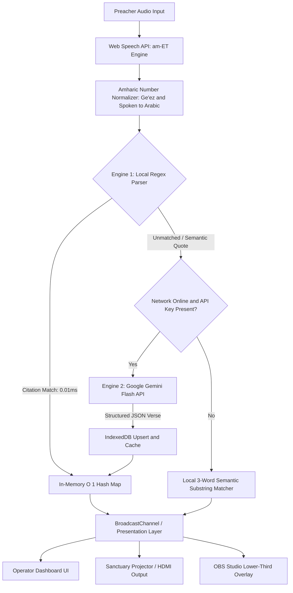

# Live Amharic Bible Projector (ቃለ እግዚአብሔር)

A real-time, voice-activated scripture projection and operator control system engineered for Amharic church services, live broadcasts, and multi-display sanctuary presentations.

Built with an offline-first architecture, the application pairs continuous browser-level speech recognition with deterministic citation parsing and optional large language model (LLM) fallback for semantic scripture quote matching.

---

## Architectural Overview

The system operates on an asymmetric dual-engine pipeline designed to guarantee high-throughput, low-latency scripture lookups under varying network reliability constraints typical of live sanctuary environments.



### Resolution Engines

#### 1. Engine 1: Deterministic Regex and O(1) Memory Index
- **Latency**: ~0.01 ms
- **Connectivity**: 100% Offline
- **Mechanism**:
  - Normalizes colloquial Amharic numerals and classical Ge'ez numbers (`፩` through `፻`) into standardized digits.
  - Applies bidirectional regular expression patterns to match any of the 66 canonical books against extensive phonetic and colloquial speech-to-text alias dictionaries.
  - Accesses the pre-indexed scripture database directly from memory using composite keys (`bookId-chapter-verse`), bypassing disk and network operations completely.

#### 2. Engine 2: Google Gemini Semantic Fallback
- **Latency**: ~500 ms – 1.2 s
- **Connectivity**: Requires internet access and a valid Gemini API key
- **Mechanism**:
  - Activated when speech input contains scripture quotes or paraphrased sermon references without explicit chapter or verse citations (for example, *"እግዚአብሔር እረኛዬ ነው የሚያሳጣኝም የለም"* or *"በመጀመሪያ ቃል ነበረ"*).
  - Queries Google's Gemini Flash model with strict schema constraints to resolve the exact book, chapter, verse span, and 1954 Haile Selassie text.
  - Automatically persists newly resolved verses into the client-side IndexedDB instance (`KaleEgziabherBibleDB`), expanding the local offline database dynamically over time.

---

## Core Capabilities

- **Continuous Speech Recognition**: Native `am-ET` acoustic modeling via the browser's SpeechRecognition API, with real-time waveform visualization via Web Audio API FFT analysis.
- **Dual-Display Multi-Window Sync**: Independent operator control panel and presentation view synchronized across screens using the browser's native `BroadcastChannel` API with automated heartbeat ping/pong failure detection.
- **Offline Persistence**: Fully functional without internet connectivity. Backed by client-side IndexedDB storage containing the 66 canonical books of the Amharic Bible.
- **Voice-Activated Navigation**: Hands-free verse iteration using voice triggers (*"ቀጥሎ ያለው ቁጥር"* for next verse, *"ያለፈው ቁጥር"* for previous verse).
- **Broadcast and OBS Integration**: Built-in lower-third overlay mode with transparent alpha channel support for live video streaming workflows.
- **Custom Presentation Modes**: High-contrast sanctuary themes (Midnight Gold, Classic Black, Navy Sanctuary, Deep Crimson) with dynamic typography scaling and emergency blackout toggles.

---

## Technology Stack

| Layer | Technologies |
| :--- | :--- |
| **Frontend Framework** | React 19, TypeScript 5.8 |
| **Build & Tooling** | Vite 6, Tailwind CSS v4 |
| **State Management** | Zustand 5 |
| **Audio & Speech** | Web Speech API (`am-ET`), Web Audio API (`AnalyserNode`) |
| **Client Storage** | IndexedDB (`KaleEgziabherBibleDB`) with in-memory `Map` caching |
| **Inter-Process Sync** | `BroadcastChannel` API |
| **Semantic AI Fallback** | Google Gemini Flash API (`gemini-flash-latest`, `gemini-3.8-flash`) |
| **Icons & UI** | Lucide React |

---

## Project Structure

```text
├── src/
│   ├── components/
│   │   ├── layout/            # Header, visualizer, status indicators
│   │   ├── modals/            # Architecture overview, settings, scripture managers
│   │   ├── operator/          # Operator control board, verse queues, picker
│   │   └── projector/         # Sanctuary display, OBS lower-third, theme engines
│   ├── data/
│   │   ├── canonical-books.ts # 66 canonical books with phonetic speech aliases
│   │   ├── initial-bible-seed.ts # Seed scripture records for offline deployment
│   │   └── preacher-presets.ts   # Simulator presets for integration testing
│   ├── hooks/                 # Keyboard listeners, speech recognition lifecycle
│   ├── services/
│   │   ├── bible-db.ts        # IndexedDB storage layer and O(1) memory map
│   │   ├── broadcast-sync.ts  # Dual-window state synchronization
│   │   ├── citation-parser.ts # Regex pattern matcher and number normalizer
│   │   ├── gemini-ai.ts       # Gemini API client with JSON schema enforcement
│   │   └── speech-recognition.ts # Web Speech API wrapper
│   ├── store/
│   │   └── useProjectionStore.ts # Centralized reactive state store
│   ├── types/
│   │   └── index.ts           # Domain interfaces and type definitions
│   ├── App.tsx                # Main routing and pipeline controller
│   └── main.tsx               # Application entry point
├── public/                    # Static assets
├── vercel.json                # Single-Page Application (SPA) rewrite definitions
└── package.json
```

---

## Getting Started

### Prerequisites

- Node.js 18.0.0 or higher
- npm 9.0.0 or higher
- A Chromium-based browser (Google Chrome, Microsoft Edge, or Brave) for Web Speech API (`am-ET`) support

### Installation

1. Clone the repository:
   ```bash
   git clone https://github.com/Girum-Birhanu/live-amharic-bible-projector.git
   cd live-amharic-bible-projector
   ```

2. Install dependencies:
   ```bash
   npm install
   ```

3. Configure environment variables:
   Create a `.env` file in the project root:
   ```env
   VITE_GEMINI_API_KEY=your_google_gemini_api_key
   ```
   *(Note: The application functions fully offline without this key using Engine 1. The key is only required if you wish to enable Engine 2 semantic AI resolution for paraphrased preaching).*

4. Run the local development server:
   ```bash
   npm run dev
   ```

5. Build for production:
   ```bash
   npm run build
   ```

---

## Operating Controls

### Keyboard Shortcuts

| Key | Action |
| :--- | :--- |
| `Space` | Toggle microphone listening on/off |
| `Arrow Right` / `Arrow Down` | Advance to the next verse in the current chapter |
| `Arrow Left` / `Arrow Up` | Return to the previous verse in the current chapter |
| `B` | Instant projector screen blackout toggle |
| `Esc` | Clear active projection |

### Spoken Voice Commands

- **"ቀጥሎ ያለው ቁጥር"** or **"ቀጣዩ ቁጥር"**: Advances the projected display to the next verse.
- **"ያለፈው ቁጥር"** or **"የቀደመው ቁጥር"**: Reverts the projected display to the previous verse.

---

## Multi-Screen & Broadcast Configuration

### Sanctuary Projector Setup (Dual Monitor)
1. Open the Operator Dashboard on your primary monitor.
2. Click **Open Projector Window** in the top control bar.
3. Drag the newly opened window to your sanctuary display or HDMI matrix output.
4. Press `F11` (or click Fullscreen) on the projection window.
5. All live verse selections, blackout commands, and theme adjustments will sync automatically via `BroadcastChannel` with zero network overhead.

### OBS Studio Lower-Third Setup
1. In OBS Studio, add a new **Browser Source**.
2. Set the URL to:
   ```text
   http://localhost:5173/projector?theme=transparent
   ```
   *(Or your production deployment URL with the same parameters)*.
3. Configure the source dimensions to match your canvas (e.g., `1920x1080`).
4. Enable the Lower-Third layout in the Operator Dashboard. Verses will render over live video with an alpha channel.

---

## Deployment (Vercel)

The repository includes a preconfigured `vercel.json` file providing standard client-side routing rewrites for Single-Page Applications:

```json
{
  "rewrites": [
    { "source": "/(.*)", "destination": "/index.html" }
  ]
}
```

### Deployment Steps
1. Push your repository to GitHub.
2. Import the project into Vercel.
3. Under **Project Settings > Environment Variables**, add:
   - Key: `VITE_GEMINI_API_KEY`
   - Value: `<Your Google Gemini API Key>`
4. Deploy.

---

## Scripture Source

Scripture texts follow the historical 1954 Haile Selassie Amharic Bible translation (*መጽሐፍ ቅዱስ*), standard across Ethiopian Orthodox Tewahedo, Evangelical, and Protestant church communities.

---

## License

This project is open-source and available under the [MIT License](LICENSE).
